# Чисте небо

Аналітика і прогноз якості повітря (PM2.5 / AQI) у містах України на відкритих даних SaveEcoBot. Є сайт на Streamlit і скрипт, що будує звіт із графіками.

**Дані: [SaveEcoBot](https://www.saveecobot.com/), ліцензія CC BY 4.0.**

Проєкт складається з двох частин, які ніде не змішуються:

| | **Аналітика: що було** | **Прогноз: що буде** |
|---|---|---|
| Що робить | Усереднює виміряні дані різними способами | Модель вчиться на минулому і продовжує закономірності вперед |
| Модулі | `analysis.py`, `insights.py`, `charts/analytics.py` | `forecast.py`, `seasonal.py`, `charts/prediction.py` |
| Графіки | сині й кольорові за AQI | усе спрогнозоване — **фіолетовий пунктир** |
| Файли звіту | `outputs/plots/0X_analytics_*.png` | `outputs/plots/XX_forecast_*.png` |

## Запуск

```bash
python -m venv .venv
.venv/Scripts/activate        # Linux/macOS: source .venv/bin/activate
pip install -r requirements.txt
streamlit run app.py          # сайт
python report.py kyiv         # 16 графіків і звіт у outputs/ (потрібен Chrome для kaleido)
pytest                        # 44 тести
```

## Дані

Папка `data/` не входить у репозиторій. Покладіть туди погодинні CSV із [SaveEcoBot](https://www.saveecobot.com/), по одному файлу на місто: `data/<city>.csv`. Формат довгий: колонки `phenomenon,value,logged_at`. Беруться рядки `pm25` та `aqi`, решта (погода) ігнорується. Якщо `aqi` немає, він рахується з `pm25` за таблицею US EPA. Нечислові й від'ємні значення та викиди (`pm25 > 500.4`) стають пропусками, дублі за годину усереднюються.

Приклади нижче: Київ, 2019-03-10 — 2026-11-16, 67 376 годинних записів.

## А. Аналітика: що було


**Тижневий AQI.** Кожна точка — середнє за тиждень, червона лінія — ковзне середнє за 4 тижні. Щозими є пік; найбрудніші роки 2020–2021.

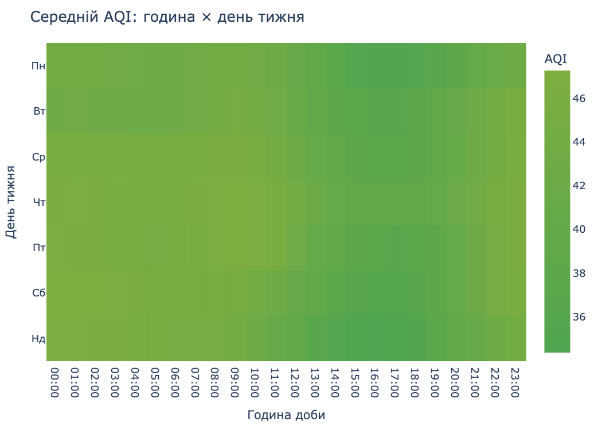
**Година × день тижня.** Найчистіше близько 16:00, найбрудніше вночі й зранку. Будні й вихідні майже не відрізняються (≈1%).

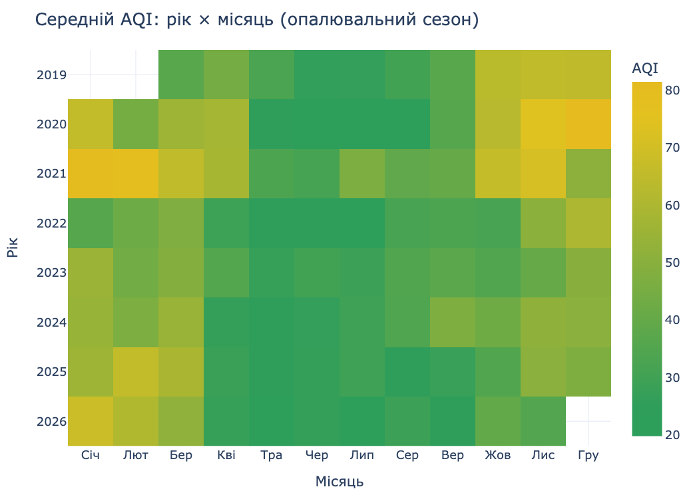
**Рік × місяць.** Опалювальний сезон: найгірший місяць у 1,9–3,5 раза брудніший за найчистіший (залежно від міста).

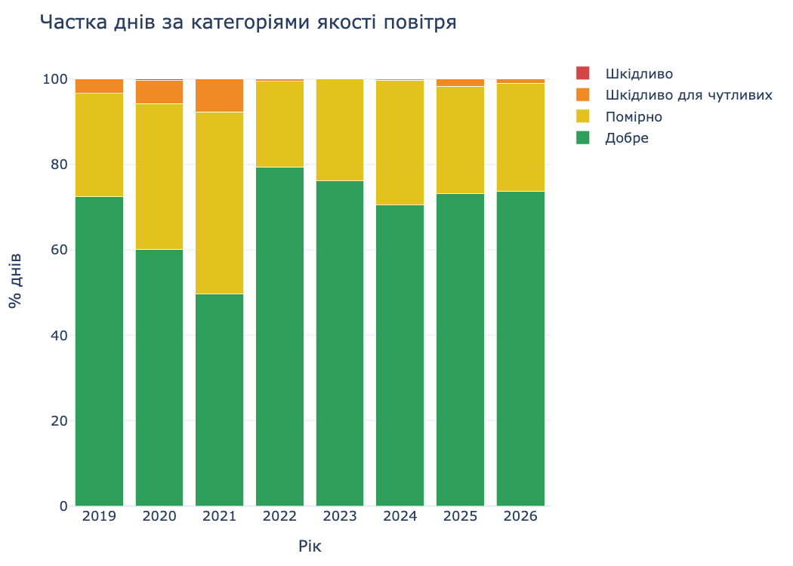
**Частка днів за категоріями.** У Києві в 2024–2026 роках 70–74% днів «Добре», решта майже вся «Помірно».

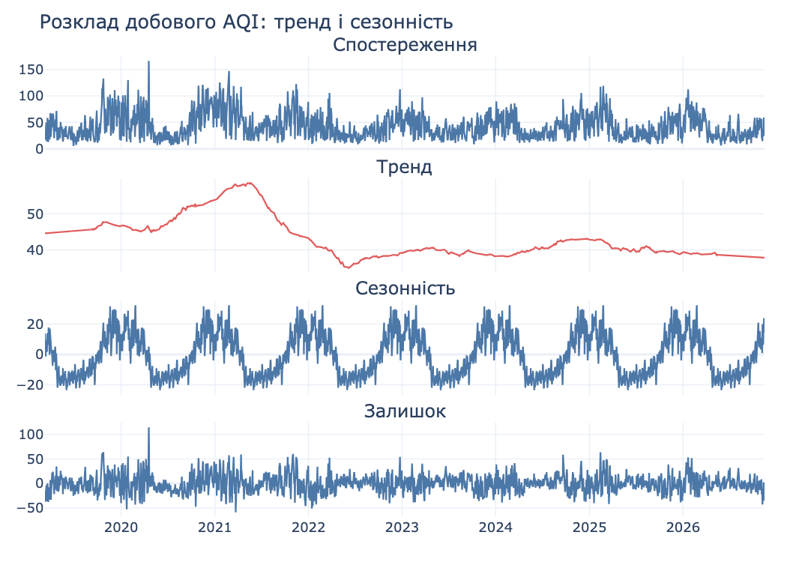
**Розклад ряду:** спостереження = тренд + сезонність + залишок. Тренд: пік 2020–2021, різке зниження 2022, далі стабільно. Сезонність — чіткий річний цикл приблизно від −20 до +30 AQI. Причин змін тренду дані не пояснюють.

Також: профілі за годиною (`03_`) і за днями тижня (`04_`).

## Б. Прогноз: що буде

### Короткостроковий прогноз на 3–14 днів

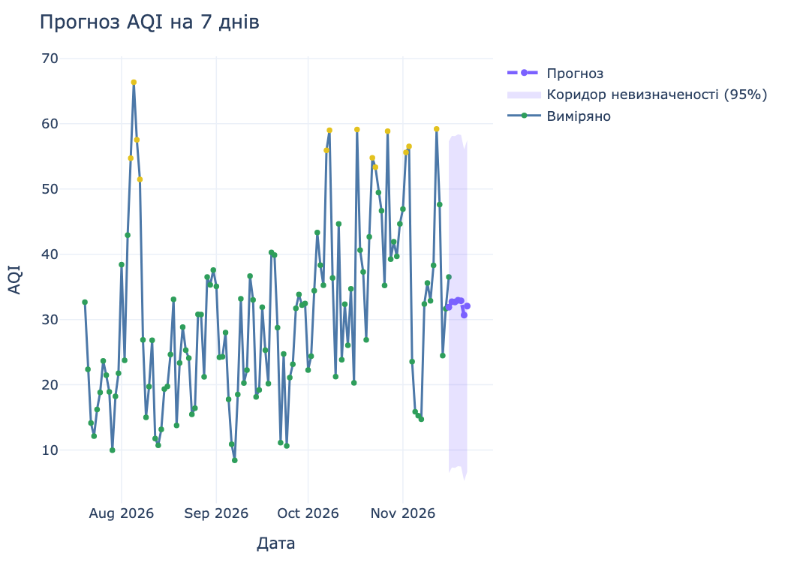
Модель Хольта–Вінтерса на добових даних (тижнева сезонність). Фіолетова тінь — коридор, у який реальне значення потрапить приблизно в 95% випадків.

Перевірка на 8 останніх тижнях (MAE, менше — краще):

| Місто | Як учора | Як тиждень тому | Хольта–Вінтерса |
|---|---|---|---|
| Дніпро | **14,98** | 16,21 | 15,83 |
| Харків | 17,60 | 19,87 | **16,16** |
| Київ | **11,72** | 14,53 | 11,88 |
| Луцьк | 13,68 | 15,58 | **13,67** |
| Львів | 13,56 | 16,24 | **13,27** |
| Одеса | 8,27 | 8,47 | **7,69** |

Модель найкраща в 4 містах із 6, але ненабагато: добовий AQI інерційний, і «як учора» — сильний еталон.

### Сезонна модель: 80% навчання, 20% тест

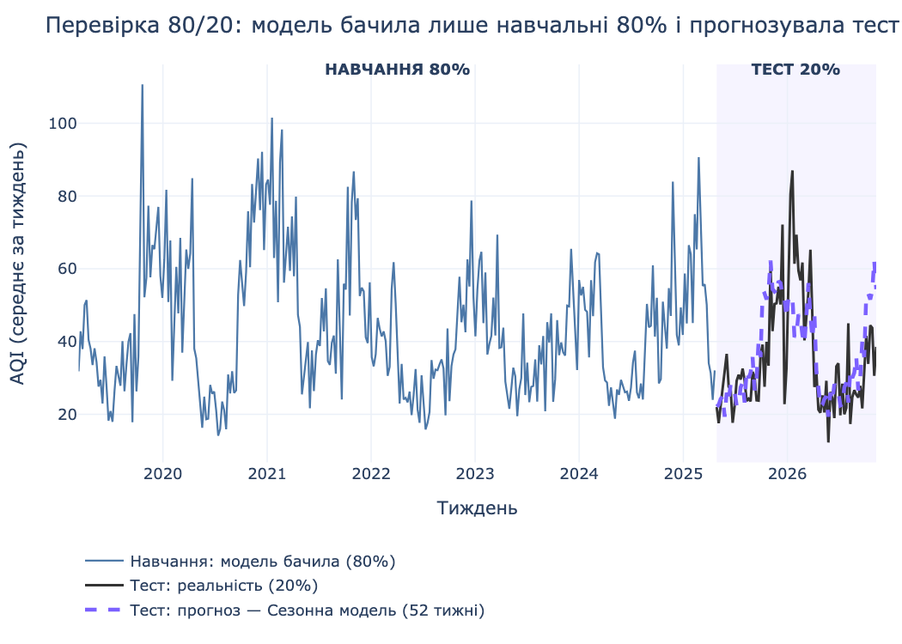
Тижневі середні ділимо в часовому порядку: **перші 80% тижнів** (Київ: 2019-03 — 2025-04, 320 тижнів) модель бачить і на них вчиться, **останні 20%** (2025-04 — 2026-11, 81 тиждень) ховаємо і прогнозуємо одним махом. Модель — Хольт–Вінтерс із 52-тижневою (річною) мультиплікативною сезонністю. Вона сама вгадала зимовий пік 2025–26, якого не бачила.

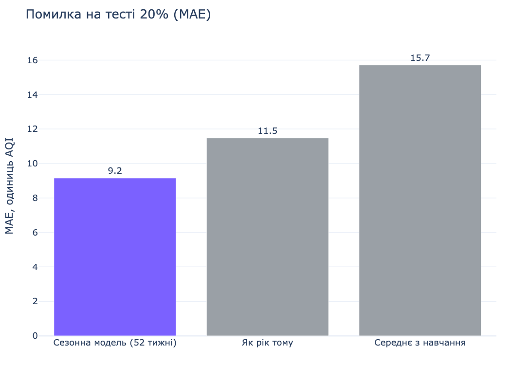

MAE на тестових 20%:

| Місто | Середнє з навчання | Як рік тому | Сезонна модель |
|---|---|---|---|
| Дніпро | 13,66 | **7,83** | 9,29 |
| Харків | 14,06 | 8,84 | **7,31** |
| Київ | 15,71 | 11,48 | **9,15** |
| Львів | 15,80 | 10,85 | **9,19** |
| Одеса | 10,33 | **6,50** | 6,97 |

Сезонна модель завжди краща за «середнє» і краща за «як рік тому» в 3 містах із 5. Для Луцька перевірка неможлива: безперервних даних менше двох років.

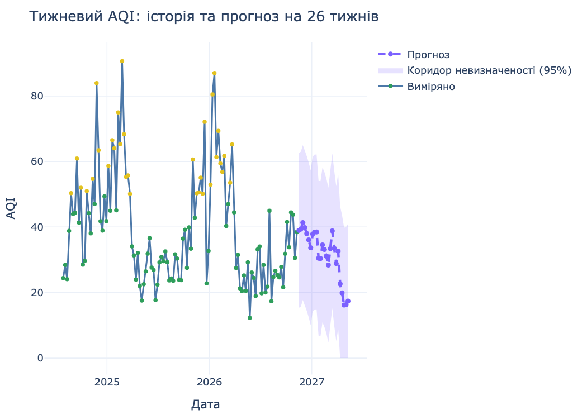
Після перевірки модель навчена на всій історії і прогнозує тижневий AQI на пів року вперед.

## В. Порівняння міст

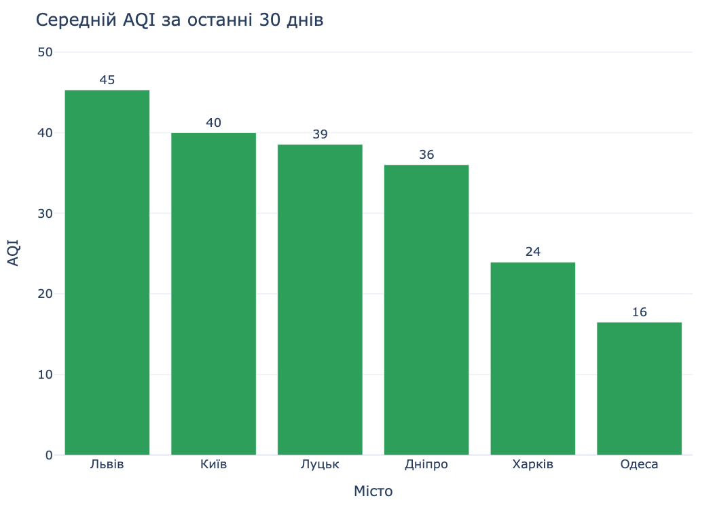
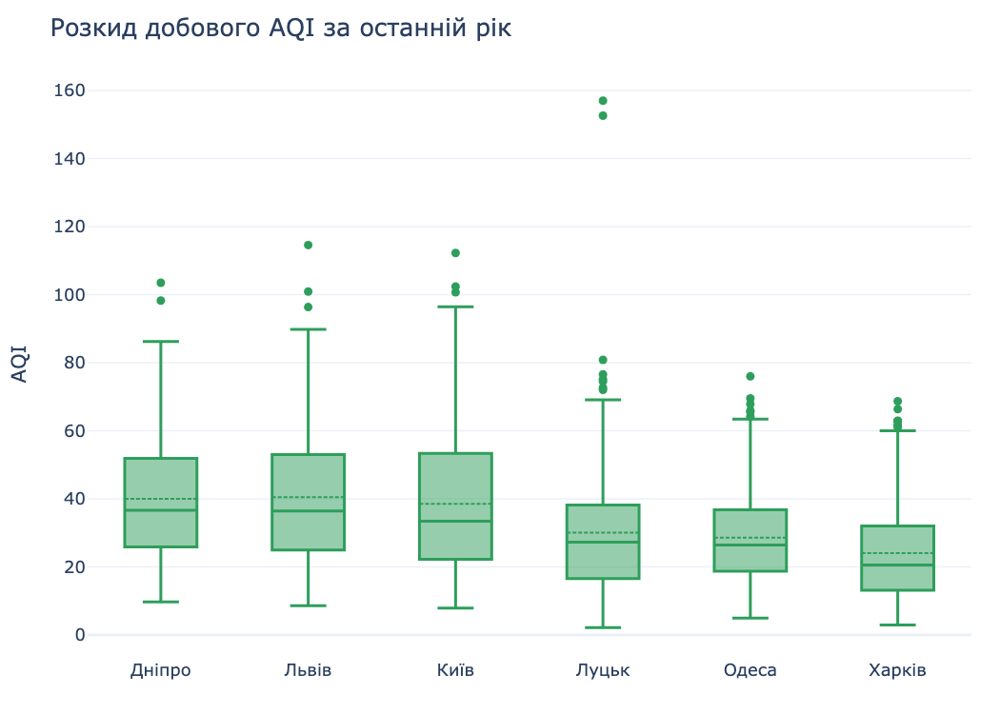
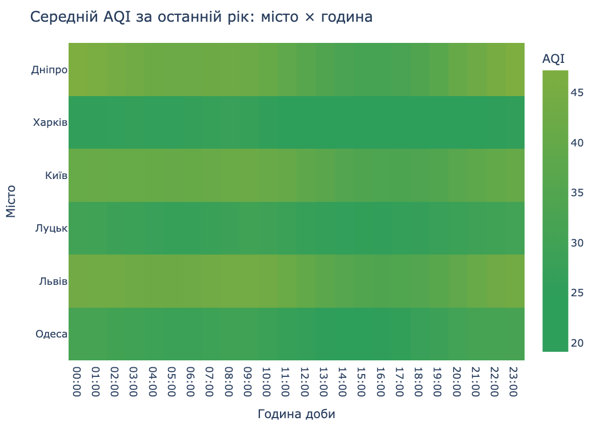

За останній рік найчистіше в Харкові (середній AQI 24), Луцьку й Одесі (28–29), найбрудніше в Києві, Дніпрі та Львові (39–41).

## Висновки

1. Головний чинник якості повітря — **сезон**: взимку значно брудніше. Тому довгостроковий прогноз має знати річну сезонність, і модель із 52-тижневим сезоном прогнозує 20% тестових даних краще, ніж «середнє».
2. Протягом доби найкраще гуляти близько 16:00; будні й вихідні майже не відрізняються.
3. На кілька днів уперед AQI змінюється мало, тому складна модель лише трохи краща за «як учора». Чесний результат — коридор невизначеності.

## Словник

Повний словник термінів (AQI, PM2.5, медіана, перцентиль, тренд, сезонність, залишок, коридор, MAE, бектест, навчальна і тестова вибірки, моделі) — у вкладці **«📖 Словник»** на сайті та в `glossary.py`. Під кожним графіком на сайті є підказка ℹ️ з поясненням.

## Структура

| Файл | Що робить |
|---|---|
| `cities.py` | список міст: папка з CSV і українські назви |
| `loader.py` | читання й чистка CSV |
| `analysis.py` | аналітика: pandas-підрахунки |
| `insights.py` | категорії AQI, поради, текстові висновки |
| `forecast.py` | короткостроковий прогноз і його перевірка, розклад ряду |
| `seasonal.py` | сезонна модель і перевірка 80/20 |
| `charts/` | графіки plotly: `base`, `analytics`, `prediction`, `cities` |
| `glossary.py` | пояснення термінів і графіків |
| `ui/` | частини сайту: картка «Зараз», вкладки, кеш даних |
| `app.py` | каркас сайту: бічна панель і вкладки |
| `report.py` | звіт: PNG і `summary.txt` |
| `tests/` | pytest |
| `CONTRACT.md` | таблиця всіх функцій |

Прогноз — статистична оцінка за історією вимірювань, а не медична порада.
